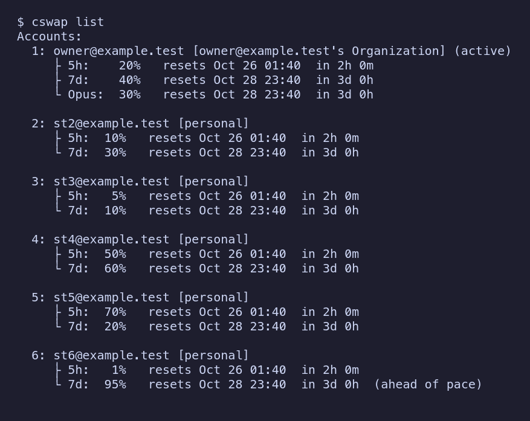

# cswap-bend

A rewrite of [claude-swap](https://github.com/realiti4/claude-swap) (`cswap`)
in [Bend 2](https://github.com/bendlang/bend): it keeps several Claude Code
accounts, reads each one's 5-hour and 7-day usage, and switches the active
login before one runs out.



More images and the commands that reproduce them: [docs/showcase.md](docs/showcase.md).

Status: under construction. It reproduces the reference cswap's behaviour
fixture by fixture (`parity/`); `docs/CUTOVER.md` is the plan for replacing a
running Python poller with it.

## Layout

| Path | What |
|---|---|
| `src/main.bend` | program entry: `rpc` / `serve`, else `src/exec.bend` |
| `src/exec.bend` | the command line: global options, dispatch, output formats |
| `src/fmt/` | output formats: CSV, YAML, TOON (over the `bend-toon-codec` BendHub package), the CSV shapes |
| `src/rpc*.bend`, `src/server.bend`, `src/effs/usock.c` | `cswap rpc` and `cswap serve` (docs/API.md) |
| `src/http.bend` | HTTPS through curl, config on stdin, header parsing |
| `tests/*_test.bend` | ground-equation unit tests (`just check`) |
| `tests/*_it.sh` | integration tests against the built binary (`just it`) |
| `LAWS.bend` / `PROOF.bend` | claims (humans write) and their proofs (`just laws`) |
| `docs/BEND-NOTES.md` | Bend 2 rules that shaped this code; read before editing |

## Use

Needs bend 2.0.38 (`.bend-version`), clang, curl and just.

```sh
just ci      # version pin, check + unit tests, proofs, lint, build + integration tests
just build   # bin/cswap-bend
```

## BendHub

Published on BendHub as `cswap-bend-cli` (version `0.1.0.0`; `bend src/main.bend --publish cswap-bend-cli@0.1.0.0`).
The name differs from the repository's because BendHub auctions names shorter
than 12 characters.

## Behaviour profiles

A profile is a named bundle of a **strategy**, a threshold, a model list, a
cooldown and an interval. `cswap auto` and a bare `cswap switch` follow the
profile in force; with none in force they behave exactly as the reference
cswap does (the parity suite pins that).

| Strategy | What it does |
|---|---|
| `best` | The reference engine: the account with the most headroom, with hysteresis, the no-return bar and recovery mode. Honours `autoswitch.strategy` (`best` or `consume-first`). The default. |
| `round-robin` | The next eligible slot after the active one, in slot order, wrapping around. |
| `soonest-reset` | The eligible account whose weekly (7d) window resets soonest, so quota is used before it is lost; ties go to more headroom. A reset that is past or unknown ranks last. |
| `sticky` | Stay on the active account until it is at the threshold or exhausted, then the eligible account with the most headroom (no hysteresis, no bar). |
| `drain-first` | The eligible account with the highest utilization that is still under the threshold, to empty accounts one by one. |

"Eligible" (every strategy but `best`): an OAuth account, enabled, not the
active slot, with a trusted reading whose headroom is above zero, and not in
backoff. A proactive switch must land below the threshold; an at-limit switch
takes any headroom (but `drain-first` never takes an account at or over the
threshold). The cooldown applies to proactive switches only. Nothing moves
while the active account's usage is unreadable (use `cswap switch NUM`).
`LAWS.bend` states and `PROOF.bend` proves these rules.

Profiles live in `settings.json` (in the backup root) next to the `autoswitch`
block; every other key of the file survives a write:

```json
{"profiles": {"night": {"strategy": "drain-first", "threshold": 95.0, "models": ["opus"],
                        "cooldown_s": 60.0, "interval_s": 30.0}},
 "active_profile": "night"}
```

Only `strategy` is required; a missing key inherits the matching `autoswitch`
setting. Built-in profiles need no entry: `default` (today's behaviour from
settings) and one named after each strategy. A stored profile with a built-in's
name overrides it; `default` cannot be changed or removed.

```sh
cswap profile list [--json]               # the profiles; * marks the active one; (x) is inherited
cswap profile show [NAME] [--json]        # one profile (default: the active one)
cswap profile use NAME [--json]           # make it active; the daemon notices on its next tick
cswap profile set NAME KEY VALUE [--json] # KEY: strategy threshold models cooldown_s interval_s
cswap profile remove NAME [--json]        # a stored profile (clears active_profile if it was this one)
cswap switch --profile NAME               # rotate once as the profile's strategy picks
cswap auto --profile NAME                 # run the daemon under a profile (active_profile untouched)
```

A `VALUE` of `inherit` clears a key. Numbers are range-checked like `cswap
config set` (threshold 50..99.9, cooldown_s 0..86400, interval_s 15..3600).

Precedence: command-line flags, then the profile, then the `autoswitch`
settings. The daemon reads `settings.json` again on every tick. Under a
profile, each `switch`, `no-switch` and `all-exhausted` event (and the daemon
log line) gains `"profile"` and `"strategy"` fields; with no profile in force
the events are unchanged. A bare `cswap switch` with no profile (or the
`default` profile) is the legacy next-slot rotation; under another profile it
rotates as that profile's strategy picks, ignoring the threshold and the
cooldown.

## Output formats

`--format text|json|csv|yaml|toon` is a global option (before or after the
verb; for `config import` and `profile import` it names the input instead). `text` is the human output and the default. `--json` is exactly
`--format json`: `list`, `status`, `switch` and `config get|list` print the same
bytes either way (the parity suite pins them). It applies to `list`, `status`,
`switch`, `config`, `profile`, `add`, `add-token`, `remove`, `import-usage`
and the `auto` event stream.

| Format | What you get |
|---|---|
| `json` | the command's JSON document, indent 2 (a command with no JSON form of its own answers `{"schemaVersion": 1, "message": "..."}`, a handled error `{"schemaVersion": 1, "error": {"type", "message"}}` on stdout, same exit code) |
| `csv` | a header line and rows (RFC 4180 quoting, LF line ends). `list`: one row per account, `slot,email,org,kind,active,5h_pct,5h_reset,7d_pct,7d_reset,fetched_at,error` (`kind` is the usage status: ok, api_key, unavailable, ...); `status`: the same columns, one row; `config`: `key,value,is_set`; `profile list`: `name,builtin,stored,active,strategy,threshold,models,cooldown_s,interval_s` (effective values; a model list is joined with `;`); `config export`: `key,value` with dotted keys; any other document: one wide row of dotted-key columns |
| `yaml` | block style, two-space indent, sequences indented under their key; strings are written plain only when no reader could take them for another type, else double-quoted |
| `toon` | [TOON](https://github.com/toon-format/spec) v3.3 by `bend-toon`; numbers are written canonically (`90.0` is `90`) |

The `auto` event stream prints one record per event: a JSON line, a CSV row
under one header line (`event,ts,profile,strategy,active_slot,from_slot,to_slot,trigger,reason,detail,message,threshold,seconds,until,slot,email,dry_run,earliest_reset_at`),
a `---` YAML document, or a TOON document followed by a blank line.

`--no-input` never reads standard input (a prompt or a `-` token becomes an
error); `--yes` answers the `remove` confirmation.

### Settings in and out

```sh
cswap config export [--format F]            # the whole settings.json, profiles included
cswap config import FILE|- [--format F] [--replace] [--data TEXT]
cswap profile export [NAME] [--format F]    # the stored profiles (or one), with active_profile
cswap profile import FILE|- [--format F] [--replace] [--data TEXT]
```

`import` reads the format from the extension (`.json`, `.yaml`/`.yml`,
`.toon`, `.csv`) or `--format` (here it names the *input*). A CSV file is
`key,value` rows with dotted keys and carries scalars only. Every known key is
checked exactly as `config set` / `profile set` check it, unknown keys, sections
and profile keys pass through, nothing is written when any value is bad, and
the write is atomic (mode 0600). The document is merged into the settings on
disk (objects key by key, anything else replaces, `null` removes the key);
`--replace` replaces the settings (for `profile import`: the profiles) instead.
`profile import` accepts only `profiles` and `active_profile`.

## Agents: rpc and serve

`cswap rpc [--format json|toon|yaml]` reads one request per line on standard
input and writes one response per line; `cswap serve --socket PATH` serves the
same protocol on a unix socket (mode 0600, one client at a time, no TCP).
Every command but `auto`, `tui` and `watch` is available. docs/API.md has the
schema and examples.

## Safety

Tokens never appear on a command line: every request is a curl run whose
config arrives on stdin. Tests use fake accounts and fake tokens only.

## License

GPL-3.0-or-later (see `LICENSE`).
